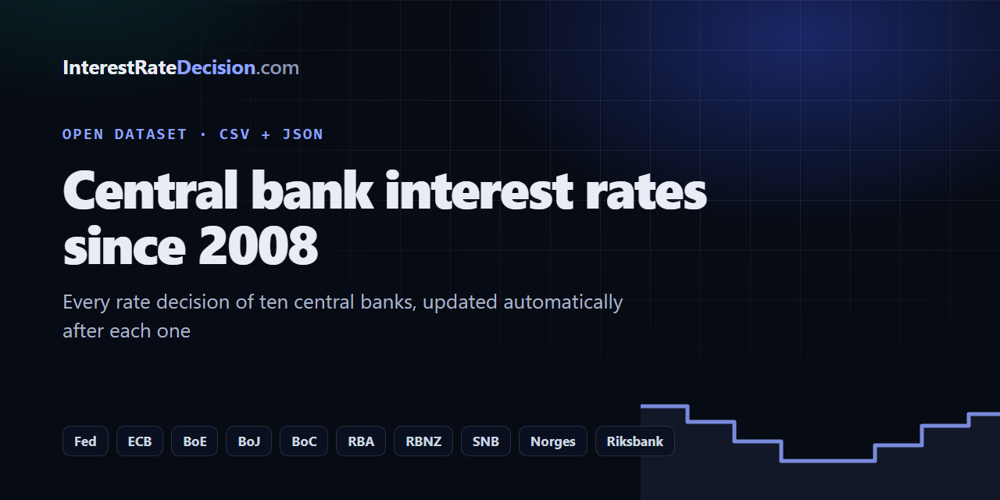

# Central Bank Interest Rates Dataset: Fed, ECB, BoE, BoJ and More Since 2008

[](https://interestratedecision.com/central-bank-data/)

[](https://github.com/Interest-Rate-Decision/central-bank-interest-rates/commits/main)
[](data/)
[](#banks-and-rates)
[](https://interestratedecision.com/)

**Every interest rate decision of ten central banks since 2008**, as free CSV and JSON: the Federal Reserve (fed funds rate), the European Central Bank (ECB deposit rate), the Bank of England (Bank Rate), the Bank of Japan, the Bank of Canada, the Reserve Bank of Australia (cash rate), the Reserve Bank of New Zealand (OCR), the Swiss National Bank, Norges Bank and Sveriges Riksbank. Updated automatically within hours of every decision.

Charts, meeting calendars, rate cut odds and what each decision did to the currency: **[InterestRateDecision.com](https://interestratedecision.com/)**.

## Contents

- [Download](#download)
- [Banks and rates](#banks-and-rates)
- [Columns](#columns)
- [Use it in Python, R, Excel, Google Sheets or JavaScript](#use-it)
- [Notes on the data](#notes-on-the-data)
- [Licence and citation](#licence-and-citation)

## Download

| File | What it holds | Live address |
| --- | --- | --- |
| [`data/decisions.csv`](data/decisions.csv) | Every decision since 2008: bank, time, rate, change in basis points | `https://interestratedecision.com/data/decisions.csv` |
| [`data/rates.json`](data/rates.json) | Each bank's policy rate today, its last change and its next decision | `https://interestratedecision.com/data/rates.json` |
| [`data/next.json`](data/next.json) | The upcoming central bank meetings, with times in UTC | `https://interestratedecision.com/data/next.json` |

This repository copies the live files every six hours ([`sync.yml`](.github/workflows/sync.yml)), so its commit history is a dated record of every change. The [releases](https://github.com/Interest-Rate-Decision/central-bank-interest-rates/releases) are snapshots.

## Banks and rates

| Central bank | Code | Policy rate | History on the web |
| --- | --- | --- | --- |
| Federal Reserve (FOMC) | `fed` | Federal funds rate, target range (the file gives the top) | [Fed funds rate history](https://interestratedecision.com/fed/rate-history/) |
| European Central Bank | `ecb` | Deposit facility rate | [ECB interest rate history](https://interestratedecision.com/ecb/rate-history/) |
| Bank of England (MPC) | `boe` | Bank Rate | [Bank of England rate history](https://interestratedecision.com/boe/rate-history/) |
| Bank of Japan | `boj` | Short-term policy interest rate | [Bank of Japan rate history](https://interestratedecision.com/boj/rate-history/) |
| Bank of Canada | `boc` | Overnight rate target | [Bank of Canada rate history](https://interestratedecision.com/boc/rate-history/) |
| Reserve Bank of Australia | `rba` | Cash rate target | [RBA cash rate history](https://interestratedecision.com/rba/rate-history/) |
| Reserve Bank of New Zealand | `rbnz` | Official cash rate (OCR) | [RBNZ OCR history](https://interestratedecision.com/rbnz/rate-history/) |
| Swiss National Bank | `snb` | SNB policy rate | [SNB rate history](https://interestratedecision.com/snb/rate-history/) |
| Norges Bank | `norges` | Policy rate | [Norges Bank rate history](https://interestratedecision.com/norges/rate-history/) |
| Sveriges Riksbank | `riksbank` | Policy rate | [Riksbank rate history](https://interestratedecision.com/riksbank/rate-history/) |

## Columns

`data/decisions.csv`, one row per decision, oldest first within each bank:

| Column | Type | Meaning |
| --- | --- | --- |
| `bank` | text | The bank's code above |
| `bank_name` | text | The bank's name |
| `time_utc` | ISO 8601 | The announcement, UTC |
| `date` | date | The announcement's date, UTC |
| `rate` | number | The policy rate after the decision, in per cent |
| `change_bp` | integer | The change against the decision before, in basis points (100 bp = 1 percentage point) |

A machine-readable description is in [`datapackage.json`](datapackage.json) (Frictionless Data).

<h2 id="use-it">Use it in Python, R, Excel, Google Sheets or JavaScript</h2>

**Python (pandas)**

```python
import pandas as pd
url = "https://raw.githubusercontent.com/Interest-Rate-Decision/central-bank-interest-rates/main/data/decisions.csv"
df = pd.read_csv(url, parse_dates=["time_utc"])
fed = df[df.bank == "fed"].set_index("time_utc")
fed.rate.plot(drawstyle="steps-post", title="Fed funds rate (top of range)")
```

Or `pip install interest-rate-decisions` ([client](https://github.com/Interest-Rate-Decision/interest-rate-decisions)).

**R**

```r
d <- read.csv("https://raw.githubusercontent.com/Interest-Rate-Decision/central-bank-interest-rates/main/data/decisions.csv")
subset(d, bank == "ecb")
```

**Google Sheets**

```
=IMPORTDATA("https://interestratedecision.com/data/decisions.csv")
```

**Excel**: Data → From Web → `https://interestratedecision.com/data/decisions.csv`

**JavaScript**

```js
const { rates } = await (await fetch("https://interestratedecision.com/data/rates.json")).json();
```

Or `npm install interest-rate-decisions` ([client](https://github.com/Interest-Rate-Decision/interest-rate-decisions)).

**On a website**: the [central bank widgets](https://github.com/Interest-Rate-Decision/widgets) show the same data, live.

## Notes on the data

- Times are the announcement in UTC. The Bank of Japan sets no fixed hour; its times are the calendar's estimate.
- A few meetings are missing from the source calendar. Where a missed one changed the rate, the next row's `change_bp` is against the last row listed, so one row can carry two decisions' change.
- Before March 2015 the source calendar gives the ECB's deposit rate only on the day a change took effect, so the ECB's `rate` is blank on those rows and `change_bp` is the change in its main refinancing rate.
- Economists' consensus forecasts are not in these files: they belong to the calendar they come from. Each decision's page on the site shows them.
- Errors of fact are listed at [interestratedecision.com/corrections/](https://interestratedecision.com/corrections/). Found one? [Open an issue](https://github.com/Interest-Rate-Decision/central-bank-interest-rates/issues).

## Licence and citation

Free to use in anything, including commercial work, **with a visible link to [InterestRateDecision.com](https://interestratedecision.com/)**. Rates and dates are public facts; the compilation is InterestRateDecision.com's. Full terms: [LICENSE.md](LICENSE.md).

Cite as: *InterestRateDecision.com, "Central bank interest rates since 2008", https://interestratedecision.com/central-bank-data/* ([`CITATION.cff`](CITATION.cff); GitHub's "Cite this repository" gives APA and BibTeX).

---

Related: [Central bank rates today](https://interestratedecision.com/central-bank-rates/) · [Central bank meeting calendar](https://interestratedecision.com/calendar/) · [Rate cut odds](https://interestratedecision.com/rate-odds/) · [How often do central banks surprise?](https://interestratedecision.com/blog/how-often-do-central-banks-surprise/)
